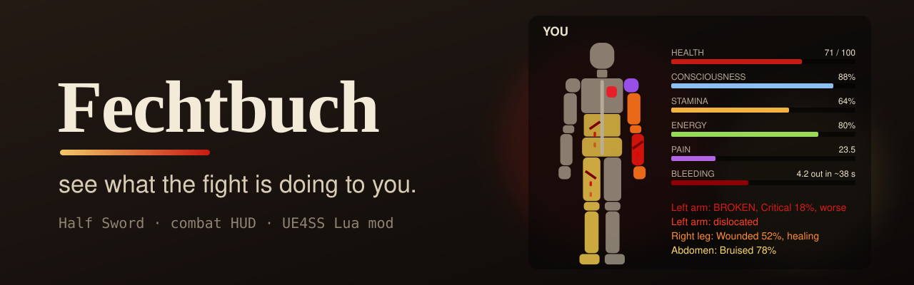
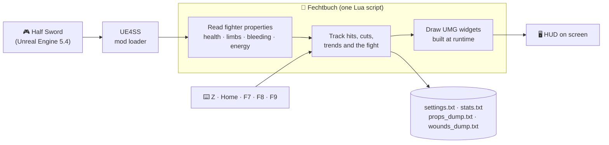

<p align="center">
  
</p>

<p align="center">
  
  
  
  
  
</p>

**Fechtbuch** is a combat HUD mod for **Half Sword** (Steam, Early Access). It shows what the game hides:
health, consciousness, stamina, energy, pain and bleeding, every broken bone and dislocated joint, where you were cut,
and how much damage you deal, for you and for the enemy you tag.

*A Fechtbuch ("fight book") is a medieval German fencing manual, the kind of treatise half-swording comes from.*

> The banner shows the layout of the in-game panel. It is a drawing, not a screenshot.

---

## ✨ What it shows

| | |
|---|---|
| 🧍 **Body diagram** | Head, neck, chest, abdomen, pelvis, shoulders, elbows, forearms, hands, thighs, knees, shins and feet. Each shape is colored by its health: bone-white, yellow, orange, red, dark red. A fresh hit flashes red. |
| 🦴 **Broken and dislocated** | A broken bone pulses dark red. A dislocated shoulder, knee, neck or spine turns violet. |
| ❤️ **Heart and spine** | The heart is drawn on the chest and beats while you live; it darkens as it is damaged. A strip down the middle shows back health. |
| 🩸 **Cuts and blood** | A red stroke marks each cut on the limb that was hit. Drops fall from every cut while you bleed, faster the more you bleed. Healed cuts disappear. |
| 📊 **Bars** | Health, consciousness, stamina, energy, pain and bleeding, with an estimate of the time you have left while you bleed out. |
| 📝 **Injury list** | For example `Left arm: BROKEN, Wounded 55%, worse`. Each wound says whether it is healing or getting worse. |
| ⚠️ **Warning** | The panel title pulses when you are losing consciousness, bleeding heavily or out of energy. |
| 🎯 **Tagged enemy** | Press **Z** on an enemy for a stats card with the same body diagram, a tag over their head and floating damage numbers. |
| 👁️ **Threat list** | The three nearest living enemies: type (enemy or revenant), distance, health, and whether they are to your left, right or behind you. |
| 🏁 **Fight recap** | When a fight ends or you fall: time, damage dealt and taken, hits, best hit and kills. |
| 💪 **Physique** | Weight, height, strength, gear weight, and progress bars for strength, weapon skill and body skill. |

## 📥 Download

| What | Download |
|---|---|
| **Installer** (recommended) | [**FechtbuchInstaller.exe**](https://github.com/Afaguayo/fechtbuch/releases/latest/download/FechtbuchInstaller.exe) |
| Mod files only | [Fechtbuch-mod.zip](https://github.com/Afaguayo/fechtbuch/releases/latest/download/Fechtbuch-mod.zip) |

## ✅ What you need

| Requirement | Why |
|---|---|
| **Half Sword** on Steam (Early Access 0.7) | The game |
| **Windows 10 or 11** | The installer and UE4SS are Windows programs |

That's it. The installer brings [UE4SS](https://github.com/UE4SS-RE/RE-UE4SS), the mod loader, with it.

## 🚀 Install

1. Download **FechtbuchInstaller.exe**.
2. Close Half Sword and run the installer. Choose **1**.
3. Start the game and fight.

The installer finds Half Sword through your Steam libraries, installs UE4SS if you don't have it, installs Fechtbuch and enables it.
Your settings are kept when you update, including settings from the older "Battle Eye" version, which the installer replaces.

Windows may show **"Windows protected your PC"** because the installer isn't signed with a paid certificate. Click **More info**, then **Run anyway**.

<details>
<summary><b>Manual install</b></summary>

1. Install the UE4SS experimental build into `Half Sword\HalfswordUE5\Binaries\Win64`, so `dwmapi.dll` and the `ue4ss` folder sit next to the game's `.exe`.
2. Extract `Fechtbuch-mod.zip` into `Win64\ue4ss\Mods\`, so you get `Mods\Fechtbuch\Scripts\main.lua`.
3. Add `Fechtbuch : 1` to `Win64\ue4ss\Mods\mods.txt`, above the `; Built-in keybinds` line.
</details>

<details>
<summary><b>Uninstall</b></summary>

Run the installer and choose **2** (Fechtbuch only) or **3** (Fechtbuch and UE4SS).
</details>

## 🎮 Keys

| Key | Action |
|---|---|
| **Z** | Tag or untag the enemy you're looking at |
| **Home** | Open or close the Fechtbuch menu (arrows to change, Enter to toggle) |
| **F7** | HUD on / off |
| **F8** | Reset the damage counters |
| **F9** | Save every property of your fighter to `props_dump.txt` (also saved once each time you start the game) |

## ⚙️ Settings menu

Press **Home** in the game. Everything is saved to `settings.txt` and survives updates.

| Setting | What it does |
|---|---|
| **Layout preset** | **Full** shows everything. **Compact** shows your bars only. **Duel** shows your bars plus the enemy card. A preset only switches pieces on or off; positions and sizes stay yours. |
| **Each piece** | Turn the body diagram, cuts and blood, every bar, the injury list, the damage summary and the physique lines on or off, for your panel and for the enemy card. |
| **Position and size** | Put each panel in one of 8 positions, nudge it, and resize it from 40% to 160%. |
| **Focus with** | How an enemy gets focused: Z tag only, or Z tag plus lock-on, crosshair or nearest enemy. |
| **Hide in menus** | Hides the HUD while the mouse cursor stays on screen (main menu, pause menu, shops). |
| **Fight recap, threat list, warning** | Each has its own switch. |

## 🩸 How cuts are placed

The game does not hand out a list of wounds, so Fechtbuch uses the best source it finds, in this order:

| Source | Precision |
|---|---|
| The **blood emitters** the game attaches to a wound | The spot on the limb, along and across it, when the emitter's position can be read |
| The game's **blood painting arrays** | The bone, and the height on the limb when the stored position checks out against the skeleton |
| The **body part that lost the most health** in the hit | The right limb, at an approximate spot |

The diagram is a flat front view, so a cut on the back shows on the same limb at the same height.
Every cut is written to `wounds_dump.txt` with the source that placed it.

## 🩺 Troubleshooting

| Problem | Fix |
|---|---|
| No HUD in a fight | Press **F7** (HUD on / off). Then open the **Home** menu and turn **Hide in menus** off, in case the game shows a cursor during play. |
| The HUD stays on a menu | Turn **Hide in menus** on in the **Home** menu. |
| Nothing shows at all | Check `ue4ss\UE4SS.log` for lines starting with `[Fechtbuch]`. No such lines means the mod isn't enabled: check `mods.txt`. |
| A game update changed something | Press **F9** in a fight and open an issue with `props_dump.txt` and `UE4SS.log`. The log lists new property names in a `[Fechtbuch] class ... unmapped:` line. |
| Still no in-game HUD | Right-click `ue4ss\Mods\Fechtbuch\overlay.ps1` and choose *Run with PowerShell* for a separate stats window. Run the game in borderless or windowed mode. |
| "Windows protected your PC" | **More info**, then **Run anyway**. |

## 🧠 How it works



- **No game files are changed.** The HUD is made of UMG widgets created while the game runs, so there is no `.pak` to install.
- **Property names are matched by name**, ignoring case, spaces and underscores. A name the game no longer has reads as empty and its readout shows `-`, instead of breaking the HUD.
- **Light on the game.** Full stats are read only for you and the focused enemy; every other fighter costs three reads per refresh. With no fight going on the HUD refreshes about 10 times a second instead of 30.
- **Everything runs on the game thread.** Key presses are only counted on the input thread and applied by the next refresh.

## 📝 Notes and limits

- Played on Half Sword Early Access **0.7.0.2** and 0.6.1.5 with UE4SS v3.0.1 Beta. The cut placement added in 1.5.1 is checked against a simulated game only; it has not been confirmed in play yet.
- The game does not say who hit whom. Damage dealt counts health lost by enemies within 5 m of you, or by the enemy you tagged at any distance, because in 0.7 factions also fight each other. A kill counts if you damaged that enemy before. Thrown or shot hits on untagged enemies further away are not counted.
- In 0.7 bleeding runs from 0 to 10. The bleeding bar and the warning (above 5) use that scale.
- The bleed-out estimate is an estimate. Weight is the physics mass of the body and height is measured from head to feet, so both are close estimates too.
- Exhaustion and fear are shown as the game stores them; their scale is not known yet.
- The game doesn't expose its own maximum for strength and skill progress; the bars treat 100% as the cap.

## 🛠️ Build from source

Needs only Windows and the .NET Framework compiler that ships with it.

```powershell
git clone https://github.com/Afaguayo/fechtbuch.git; cd fechtbuch
powershell -ExecutionPolicy Bypass -File installer\build.ps1
```

This packs the mod with UE4SS into `dist\FechtbuchInstaller.exe` and writes `dist\Fechtbuch-mod.zip`.
Without arguments it downloads the latest UE4SS experimental build. Pass `-UE4SSZip <path>` to bundle a specific UE4SS zip; the releases bundle v3.0.1 Beta, the build the mod was played with.

### 📁 Layout

```
Fechtbuch/Scripts/main.lua   the whole mod
Fechtbuch/overlay.ps1        fallback stats window
installer/Installer.cs       the installer (C#, one file)
installer/build.ps1          builds the installer and the mod zip
docs/                        banner, HUD notes for 0.7
third_party/                 UE4SS license
```

## 🙏 Credits

- [UE4SS](https://github.com/UE4SS-RE/RE-UE4SS) (MIT, see `third_party/UE4SS-LICENSE`) loads the mod and is bundled in the installer.
- The first property names came from [HalfSwordTrainerMod](https://github.com/massclown/HalfSwordTrainerMod).

---

<p align="center">Built by <a href="https://github.com/Afaguayo">@Afaguayo</a> · MIT License</p>
